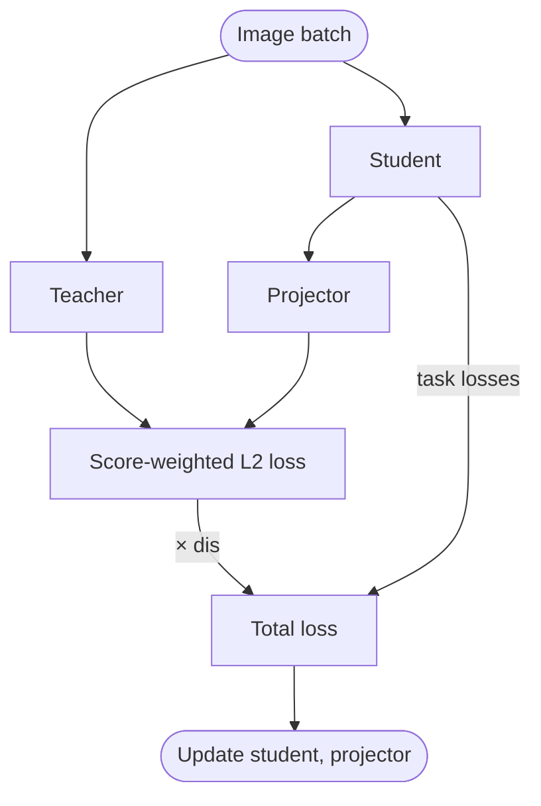

# Knowledge Distillation

## Quickstart

Train a smaller student model with guidance from a larger teacher model by adding the `distill_model` argument:

!!! example

    === "Python"

        ```python
        from ultralytics import YOLO

        model = YOLO("yolo26n.pt")
        model.train(data="coco8.yaml", epochs=100, distill_model="yolo26s.pt")
        ```

    === "CLI"

        ```bash
        yolo train model=yolo26n.pt data=coco8.yaml epochs=100 distill_model=yolo26s.pt
        ```

## What is Knowledge Distillation?

[Knowledge distillation](https://www.ultralytics.com/glossary/knowledge-distillation) transfers knowledge from a large, accurate **teacher model** to a smaller **student model**. The student learns to mimic the teacher's internal feature representations, often achieving better accuracy than training from scratch.


**Use distillation when:**

- You need a smaller, faster model for deployment
- You have a high-accuracy teacher model trained on the same data
- You want better accuracy than standard training provides

!!! note

    Knowledge distillation is implemented for **detect**, **segment**, **pose**, and **obb** tasks. Only **detect** has been experimentally verified for accuracy improvements for now.

## Performance

The results in this section report the built-in `sl2` method, rather than CanKD or BTKD++.

Knowledge distillation improves student [mAP](yolo-performance-metrics.md) across the entire YOLO26 family on [COCO](https://github.com/ultralytics/ultralytics/blob/main/ultralytics/cfg/datasets/coco.yaml), with no added inference cost. The table below compares the standard YOLO26 models (baseline) against the same models trained with distillation from their recommended teacher.

| Model                                                                  | size<br><sup>(pixels)</sup> | mAP<sup>val<br>50-95</sup><br>baseline | mAP<sup>val<br>50-95</sup><br>distilled | mAP<sup>val<br>50-95 (e2e)</sup><br>baseline | mAP<sup>val<br>50-95 (e2e)</sup><br>distilled |
| ---------------------------------------------------------------------- | --------------------------- | -------------------------------------- | --------------------------------------- | -------------------------------------------- | --------------------------------------------- |
| [YOLO26n-distill](https://platform.ultralytics.com/ultralytics/yolo26) | 640                         | 40.9                                   | **41.5**                                | 40.1                                         | **40.9**                                      |
| [YOLO26s-distill](https://platform.ultralytics.com/ultralytics/yolo26) | 640                         | 48.6                                   | **49.2**                                | 47.8                                         | **48.6**                                      |
| [YOLO26m-distill](https://platform.ultralytics.com/ultralytics/yolo26) | 640                         | 53.1                                   | **53.9**                                | 52.5                                         | **53.3**                                      |
| [YOLO26l-distill](https://platform.ultralytics.com/ultralytics/yolo26) | 640                         | 55.0                                   | **56.0**                                | 54.4                                         | **55.5**                                      |
| [YOLO26x-distill](https://platform.ultralytics.com/ultralytics/yolo26) | 640                         | 57.5                                   | **57.9**                                | 56.9                                         | **57.4**                                      |

- **mAP<sup>val</sup>** values are for single-model single-scale on the [COCO val2017](https://cocodataset.org/) dataset. <br>Reproduce a distilled row with `yolo val detect model=yolo26n-distill.pt data=coco.yaml device=0`; add `nms=False` for the e2e column.
- **e2e** values use the NMS-free inference path (`nms=False`); non-e2e values use default NMS post-processing (`nms=None`). See [End-to-End Detection](end2end-detection.md) for details.

## Prerequisites

Before you begin, ensure you meet the following requirements:

- **Trained teacher model**: a `.pt` checkpoint from the same YOLO family as the student.
- **Matching task**: use a teacher for the same task as the student and train it on relevant data.
- **GPU resources**: enough memory to hold both models; the teacher runs forward-only without gradients or optimizer state.

### Recommended Model Pairs

| Student      | Recommended Teacher |
| ------------ | ------------------- |
| `yolo26n.pt` | `yolo26s.pt`        |
| `yolo26s.pt` | `yolo26m.pt`        |
| `yolo26m.pt` | `yolo26x.pt`        |
| `yolo26l.pt` | `yolo26x.pt`        |

Cross-family distillation (e.g., YOLO11 teacher with YOLO26 student) is **not supported**.

## Key Parameters

| Parameter        | Type    | Default | Description                                                                                                             |
| ---------------- | ------- | ------- | ----------------------------------------------------------------------------------------------------------------------- |
| `distill_model`  | `str`   | `None`  | Path to the teacher model file (e.g., `yolo26x.pt`). Setting this enables knowledge distillation.                       |
| `distill_method` | `str`   | `'sl2'` | Loss method: score-weighted L2 (`sl2`), cross-attention non-local distillation (`cankd`), or BTKD++ detection (`btkd`). |
| `dis`            | `float` | `6.0`   | Distillation loss weight. CanKD applies this once to `mean MSE / 2`; use `10.0` for the official detection setting.     |

## How It Works

The default `distill_method="sl2"` follows these steps:

1. The **teacher model** remains frozen in `eval` mode and runs inference on each batch
2. The **student model** trains with standard task losses plus distillation guidance
3. Features are extracted from both models at the three neck layers that feed the Detect-family head
4. A projector of two **1×1 convolutions with ReLU** aligns each student feature map to the teacher's channels
5. A **score-weighted L2 loss** compares projected student features with teacher features, weighted by the teacher's classification confidence
6. The distillation loss combines with standard losses using the `dis` weight



### CanKD

Set `distill_method="cankd"` to use [CanKD](https://github.com/tori-hotaru/CanKD), following the official
`NLKD_IN_Loss` implementation and the [paper](https://arxiv.org/abs/2511.21503). For each neck feature level:

1. A single **1×1 convolution**, without activation or normalization, aligns student channels to teacher channels when
   they differ. Its Kaiming-normal fan-out initialization and zero bias match the official `ConvModuleConnector`.
2. Student queries and teacher keys form a **dot-product affinity divided by the number of pooled teacher positions**,
   without softmax or temperature scaling.
3. **2×2 max pooling** is applied to teacher key and value embeddings. Their embedding width is half the teacher channels.
4. The attended teacher values pass through a **1×1 convolution and BatchNorm**, whose scale and bias start at zero,
   then are added to the aligned student features through a residual connection.
5. **Instance Normalization** (`affine=False`) is applied to both enhanced student and teacher features, followed by
   **mean MSE / 2 × dis**. Losses are summed across feature levels and use the same batch scaling as the built-in KD loss.

The original student features continue to feed the detection head. CanKD does not use teacher confidence weights.
Aligners and Can blocks are trained, included in EMA, and restored together on resume; inference and export retain only
the student. YOLO26 uses its existing P3–P5 features, with no model YAML changes. Each feature map must be at least
2×2 for the official pooling operation, including when multi-scale training changes the image size.

Feature alignment and the CanKD loss run in FP32, including when `amp=True`. Teacher and student forward passes
continue to follow the trainer's AMP setting.

```python
from ultralytics import YOLO

student = YOLO("yolo26n.pt")
student.train(
    data="dataset.yaml",
    distill_model="teacher_yolo26s.pt",  # teacher already fine-tuned on the target dataset
    distill_method="cankd",
    dis=10.0,  # official loss_weight=10 gives 5 × mean MSE
)
```

```bash
yolo train model=yolo26n.pt data=dataset.yaml distill_model=teacher_yolo26s.pt distill_method=cankd dis=10.0
```

For a built-in KD comparison, use `distill_method="sl2"`. Keep the teacher checkpoint, student initialization, dataset
splits, and training settings consistent, and select loss weights on the validation split. This ports the CanKD method to
YOLO; it does not reproduce the paper's OpenMMLab detector experiments or the additional CanKD† weight-inheritance setting.

### BTKD++ for Object Detection

Set `distill_method="btkd"` to use the object detection extension of
[BTKD++](https://doi.org/10.1007/s11263-026-02924-x), following Sections 3.3-4.1 and Appendix A:

1. Temporary hooks observe the student criterion's existing task-aligned assignments. Teacher and student outputs
   use the same assigned positive grid positions; assignment is neither changed nor repeated.
2. A positive is easy when the teacher predicts the assigned class correctly and its box IoU is at least **0.65**.
   Other positives are hard. Background positions do not receive this additional loss.
3. Class logits use temperature **2**. Each decoded box coordinate is represented by a truncated Gaussian over
   **128 bins**, with standard deviation **2 bins**. GT coordinates identify one-hot target bins.
4. Hard targets use proportional label-guided rectification on probabilities: only the GT/wrong-argmax pair changes,
   preserving its total probability mass and every other entry. Already-correct pairs remain unchanged.
5. Easy and hard KL losses are normalized separately. The linear curriculum is
   `gamma = (epoch + 1) / epochs` for the trainer's zero-based epoch index. The added loss is
   `dis * ((1 - gamma) * easy_loss + gamma * hard_loss)`; box losses sum over the four coordinates.

For anchor-free YOLO heads, decoded teacher, student, and GT boxes use **image-normalized xyxy** coordinates clipped
to `[0, 1]`. The anchor-relative offset ranges in the paper's table are not applied to pixel coordinates. This is an
adaptation to the native YOLO output interface, rather than a reproduction of the paper's training results.
One-class detection uses an auxiliary binary background/foreground distribution, so class KD remains meaningful.

BTKD++ currently supports **detect only**. Teacher and student must have identical class names/order, feature strides,
spatial grids, and prediction branches, with unfused detection heads. Internal channel widths may differ. YOLO26
distills both branches using the native one-to-many/one-to-one weights and retains the existing backbone detach.
Its `reg_max=1` head is unchanged: Gaussian bins exist only inside the additional loss.

The full BTKD++ loss runs in FP32 under `amp=True`; model forwards retain the trainer's AMP setting. Empty positive,
easy, or hard sets produce a differentiable zero contribution. No feature projectors or trainable KD layers are added.
The native supervised loss remains unchanged, and `distill_model=None` retains ordinary training. Resume recomputes
the curriculum from the resumed epoch and total training budget. Final stripped checkpoints retain only the student.

```python
from ultralytics import YOLO

student = YOLO("yolo26n.pt")
student.train(
    data="dataset.yaml",
    distill_model="teacher_yolo26s.pt",  # teacher trained on the same classes, in the same order
    distill_method="btkd",
    dis=1.0,  # example starting weight; select on validation data, independently of CanKD's weight
    amp=True,
)
```

For structured-pruning recovery, keep the custom trainer that loads the actual pruned module instead of reconstructing
it from YAML, and keep its custom pruning classes importable in DDP workers. The BTKD++ wrapper preserves that student
object. CanKD-specific notebook checks for projector gradients must be adapted, since BTKD++ has no projectors.

## Task Support

The `sl2` and `cankd` implementations extract features from the three neck layers that feed the model's Detect-family head. Because the **segment**, **pose**, and **obb** heads inherit from the same `Detect` architecture, these two methods are technically compatible with those tasks as well. The `btkd` method supports **detect only**.

Classification, semantic segmentation, depth estimation, and RT-DETR do not use a compatible Detect-family head and are not supported.

!!! warning

    Only **detect** has been experimentally benchmarked and verified. You can run distillation for **segment**, **pose**, or **obb**, but accuracy improvements for those tasks are not yet validated.

!!! example "Knowledge Distillation for Other Tasks"

    === "Python"

        ```python
        from ultralytics import YOLO

        # Segment
        model = YOLO("yolo26n-seg.pt")
        model.train(data="coco8-seg.yaml", epochs=100, distill_model="yolo26s-seg.pt")

        # Pose
        model = YOLO("yolo26n-pose.pt")
        model.train(data="coco8-pose.yaml", epochs=100, distill_model="yolo26s-pose.pt")

        # OBB
        model = YOLO("yolo26n-obb.pt")
        model.train(data="dota8.yaml", epochs=100, distill_model="yolo26s-obb.pt")
        ```

    === "CLI"

        ```bash
        # Segment
        yolo segment train model=yolo26n-seg.pt data=coco8-seg.yaml epochs=100 distill_model=yolo26s-seg.pt

        # Pose
        yolo pose train model=yolo26n-pose.pt data=coco8-pose.yaml epochs=100 distill_model=yolo26s-pose.pt

        # OBB
        yolo obb train model=yolo26n-obb.pt data=dota8.yaml epochs=100 distill_model=yolo26s-obb.pt
        ```

## Training

### Basic Training

Training with distillation is identical to standard training. Provide the `distill_model` path to enable it:

!!! example "Knowledge Distillation Training"

    === "Python"

        ```python
        from ultralytics import YOLO

        # Load a student model
        student = YOLO("yolo26m.pt")

        # Train with knowledge distillation from a larger teacher model
        results = student.train(data="coco8.yaml", epochs=100, distill_model="yolo26x.pt")
        ```

    === "CLI"

        ```bash
        yolo detect train model=yolo26m.pt data=coco8.yaml epochs=100 distill_model=yolo26x.pt
        ```

### Adjusting the Distillation Loss Weight

The `dis` parameter (default: `6.0`) controls distillation loss contribution:

!!! example "Custom Distillation Weight"

    === "Python"

        ```python
        from ultralytics import YOLO

        student = YOLO("yolo26n.pt")
        results = student.train(data="coco8.yaml", epochs=100, distill_model="yolo26s.pt", dis=10.0)
        ```

    === "CLI"

        ```bash
        yolo detect train model=yolo26n.pt data=coco8.yaml epochs=100 distill_model=yolo26s.pt dis=10.0
        ```

### Resuming Distillation Training

Distillation training supports resuming from checkpoints. The teacher model is rebuilt automatically from the `distill_model` path recorded in the checkpoint:

!!! example "Resume Distillation Training"

    === "Python"

        ```python
        from ultralytics import YOLO

        student = YOLO("runs/detect/train/weights/last.pt")
        results = student.train(resume=True)
        ```

    === "CLI"

        ```bash
        yolo detect train resume model=runs/detect/train/weights/last.pt
        ```

## Training Output

When distillation is enabled, an additional `dis_loss` column appears in training logs:

```text
      Epoch    GPU_mem   box_loss   cls_loss    l1_loss   dis_loss  Instances       Size
      1/80      46.2G      1.566      5.404    0.003249      6.658        231        640
```

The exported model contains **only the student weights**—file size and inference speed match a normally trained student model.

## FAQ

### Why is my distillation loss not decreasing?

- Verify teacher and student are from the **same YOLO generation**
- Confirm `distill_model` path is correct and the file loads
- Try increasing `dis` if the loss value is very small
- Ensure the teacher model is trained on the **same dataset**

### How does distillation differ from standard training?

Add the `distill_model` parameter—everything else works identically. An extra distillation loss computes during training, but the saved model is a standard YOLO model with no overhead.

### Does knowledge distillation slow down training?

Yes. The teacher adds a forward pass for every batch, so the time and memory overhead depend on the teacher/student pair. The teacher runs in `eval` mode without gradients or optimizer state.

### Which tasks and models are supported?

Knowledge distillation works with **detect**, **segment**, **pose**, and **obb** tasks because it distills features from the three neck layers that feed the Detect-family head. **Classify**, **semantic**, **depth**, and RT-DETR are not supported.

Only **detect** has been experimentally verified for accuracy improvements. Segment, pose, and obb are technically compatible but not yet benchmarked.

The teacher and student must belong to the **same YOLO family** (e.g., YOLOv8, YOLO11, or YOLO26). Cross-family distillation (e.g., a YOLO11 teacher with a YOLO26 student) is not supported.
